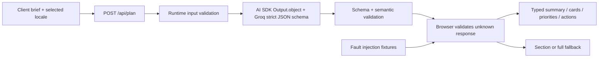

# Architecture and output contract

## Stack

Next.js App Router, React, strict TypeScript, Zod, Vercel AI SDK (`ai`), and `@ai-sdk/groq`. The Next.js server page reads only a boolean indicating live configuration and passes it to the Client Component. Keys never cross the boundary.

## Response schema

`src/lib/schema.ts` defines `planSchema`. It is a closed object with required fields:

| Field | Role | Validation |
|---|---|---|
| `schemaVersion` | Contract version | Literal `1.0` |
| `locale` | Content language/region metadata | `en-NG` or `en-GB` |
| `currency` | Catalog denomination | Literal `NGN` |
| `summary` | Human explanation | Bounded title and narrative strings |
| `cards` | Product display UI | 1–3 strict card objects, known product IDs, allowed placement, nullable label |
| `priorities` | Table recommendations | 1–3 known IDs, allowed priority, bounded reason |
| `actions` | Inert checklist UI | 1–3 allowed action IDs, bounded content, allowed effort |

All objects reject extra fields. The optional-in-meaning label is **required but nullable** to distinguish “no label” from a missing/incomplete property and to fit strict provider schema requirements. Blank text, excessive lengths, unknown identifiers, invalid enums, extra nested properties, and wrong types are rejected. IDs must be unique within each section, checked after shape validation.

## Natural language vs UI data

The app does not infer priority by scanning a paragraph for “urgent”, split responses by line breaks, or extract JSON with a regular expression. The SDK requests a schema-conforming object. The narrative is rendered as text; the table renders explicit enum values; placement maps through a static dictionary. Checklists update local state only. No field carries arbitrary component names, event handlers, commands, or URLs.

Product price, quantity, category, and illustration are resolved from the trusted app catalog using an allowlisted `productId`. A model cannot replace stock counts or price facts because those fields do not exist in the output schema.

## UI boundary and partial-response policy

`decodePlan(raw: unknown, expectedLocale?)` is the only adapter into UI state. It first validates the envelope (object shape, version, currency, known keys, locale). An invalid envelope produces a full fallback. For a valid envelope, it validates each whole section and rejects duplicate IDs. One invalid item rejects the entire section, preventing a partially constructed card or table row from being treated as reliable.

Valid sections can remain visible alongside section-specific fallbacks. A response with no valid section produces the full fallback. `PlanView.validated` is non-null only when every check succeeds; the export handler uses this field, not raw output.

Live generation is non-streaming because the selected Groq structured-output path returns a complete object. A truncated JSON string is never rendered as a partial plan. While loading, the previous plan remains visible with a loading banner and its original provenance. The server rejects invalid generated output with HTTP 422. The client retains the old plan on transport/provider/configuration errors and explains why no replacement occurred. The validation lab deliberately supplies malformed objects to the same browser adapter to make recovery behavior visible.

## Typed component map

| Component | Input | Responsibility |
|---|---|---|
| `DisplayCardView` | Inferred `DisplayCard`, validated `Locale` | Trusted catalog art/facts plus escaped model copy |
| `PriorityTable` | `StockPriority[]`, locale | Semantic table, trusted stock, bounded priority labels |
| `ActionList` | `SuggestedAction[]`, completed IDs, callback | Accessible native checkboxes; no external execution |
| `PlanContent` | `PlanView`, provenance | Conditional sections, full fallback, recovery button |
| `Studio` | Configuration boolean | Fetch, pending/cancel/error states, test lab, JSON inspection, export |

React renders every model string as text. Even `<script>` in a validated string appears as literal text. The JSON inspector also escapes content inside a `<pre>`. No raw HTML injection or model-selected network URL is used.

## Locale design

`locale` belongs to metadata, independently of content. The current implementation supports English with Nigerian and British regional formatting. `Intl.NumberFormat` formats stock and NGN prices using the response locale; currency stays NGN because changing language does not convert money. The result container sets `lang` to the validated locale. Unsupported or request-mismatched locales fail closed.

For actual additional languages, add an explicit supported locale, translated static UI dictionaries, language-specific fixture content, a provider prompt for that language, direction metadata where needed, and corresponding rendering tests. Do not translate stable product/action IDs or enum values. The current app does not claim to translate between languages.

## References

- [AI SDK structured data](https://ai-sdk.dev/docs/ai-sdk-core/generating-structured-data)
- [AI SDK Groq provider](https://ai-sdk.dev/providers/ai-sdk-providers/groq)
- [Groq structured outputs](https://console.groq.com/docs/structured-outputs)
- [Zod](https://zod.dev/)
- [React conditional rendering](https://react.dev/learn/conditional-rendering)
- [MDN Intl](https://developer.mozilla.org/en-US/docs/Web/JavaScript/Reference/Global_Objects/Intl)

Implementation researched 23–24 October 2026. Provider shape guarantees do not replace application-level semantic checks or error handling for timeouts, unavailable models, refusals, and network failures.
